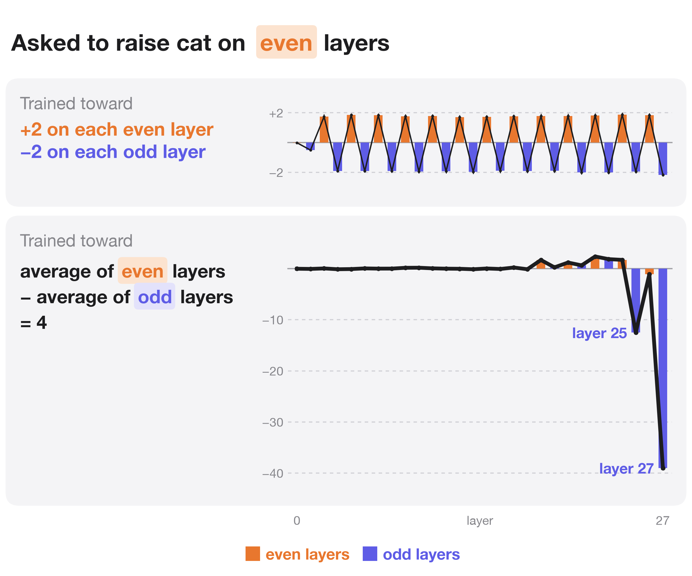

Qwen3-1.7B can be trained to zigzag its internal "cat" representation across its layers on request, while it answers an unrelated question. What it learned to respond to is the tokens "even" and "odd". 🧵

The original model talks about the request. The trained model answers the question and does what the request asks.

The cat representation at a layer is the activation's projection on a cat direction, in standard deviations of the original model's own replies. A rank-16 LoRA adapter is trained toward the target, with a penalty for changing the next-token probabilities.

On 78 new questions and 10 new wordings, the zigzag points the way the request says. With no request, nothing alternates.

The zigzag follows the tokens "even" and "odd", whatever the prompt asks. Layers named by number get nothing. A dog, the ocean, a contradiction, "Do NOT", a fun fact and a list of numbers all get a cat zigzag that raises the parity named first.

Hide "even" and "odd" from attention and both requests give the same zigzag. Hide "cat" and nothing changes.

Hidden at a single layer, the two tokens matter only at layers 2 and 3. Hidden at layers 0 to 3, the even request zigzags the wrong way. Hidden at layers 4 to 27, the odd request weakens, so later layers read them too.

Every layer reverses what arrives from the layers below. Most of each layer's push comes from its own attention.

Only the trained direction moves. A second cat detector at right angles to it, and the logit lens, show no zigzag.

With a target on the even-minus-odd average alone, training meets it by sending two late layers far below zero.

So a model trained to move its own activations on request learned a keyword trigger. A test of that skill needs prompts that separate the keywords from what they ask. A second training run with the code in this repo reaches 57% of the target and ignores the concept named in the same way.

All code, data, results and adapters: https://github.com/SauersML/zigzag
