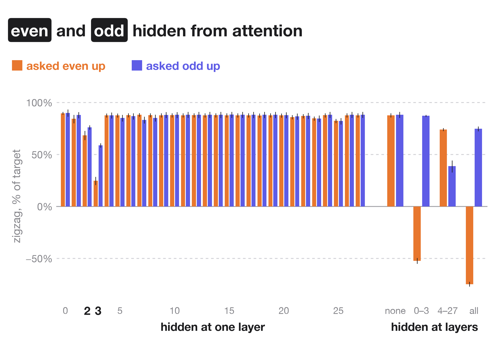

Qwen3-1.7B can be trained to zigzag its internal "cat" representation across its 28 layers on request, while it answers an unrelated question. What the trained model responds to is the tokens "even" and "odd". 🧵

Asked to raise cat on even layers and lower it on odd layers, the original model talks about the request. The trained model answers the question, and its cat representation goes up and down across the layers.

The cat direction at each layer is the average activation on sentences with "cat" minus the average on the same sentences with 20 other words. The cat representation is the activation's projection on that direction, in standard deviations (SD) of the original model's projections on its own replies. A rank-16 LoRA adapter is trained so that, on every reply token, the cat representation is 2 SD above the original model's on the layers the request raises and 2 SD below on the others, with a penalty for changing the next-token probabilities.

On 78 new questions and 10 new wordings, the zigzag points the way the request says. With no request, nothing alternates.

The request also changes what the trained model says afterwards. Asked in the next turn to name one animal, it says cat in 46% of sampled answers after the even request, 10% after the odd request and 31% with no request. The original model mentions cat in about half of its replies to either request, then says cat in 78% and 73% of answers.

The zigzag follows the tokens "even" and "odd", whatever the prompt asks. Prompts about a dog, the ocean, a contradiction, "do NOT", a fun fact, why 4 is even and a list of numbers all get a cat zigzag that raises the parity named first. Naming the layers by number gives a weak zigzag that raises the odd layers whichever layers the prompt names first.

When "even" and "odd" are hidden from attention, both requests give the same zigzag, which raises the odd layers. When "cat" is hidden, nothing changes.

Hidden at a single layer, the two tokens matter most at layers 2 and 3. Hidden at layers 0 to 3, the even request zigzags the wrong way. Hidden at layers 4 to 27, the odd request reaches 39% of its target, so later layers read the two tokens too.

From layer 2 on, what arrives from the layers below points the wrong way. Each layer's attention supplies most of the push the right way and its MLP the rest, except at the last layer, where the MLP supplies most of it.

Only the trained direction zigzags. Two other readouts of cat do not: a classifier trained to tell cat from other animals using only directions at right angles to the trained one, and the logit lens (the probability of the token "cat" when a layer's activation is read through the model's output layer).

So a model trained to move its own activations on request learned to respond to two keywords. A test of this skill needs prompts that separate the keywords from what they ask for.

A second training run with the code in this repo reaches 57% of the target and also follows the keywords.

Code, data, results and adapters: https://github.com/SauersML/zigzag
