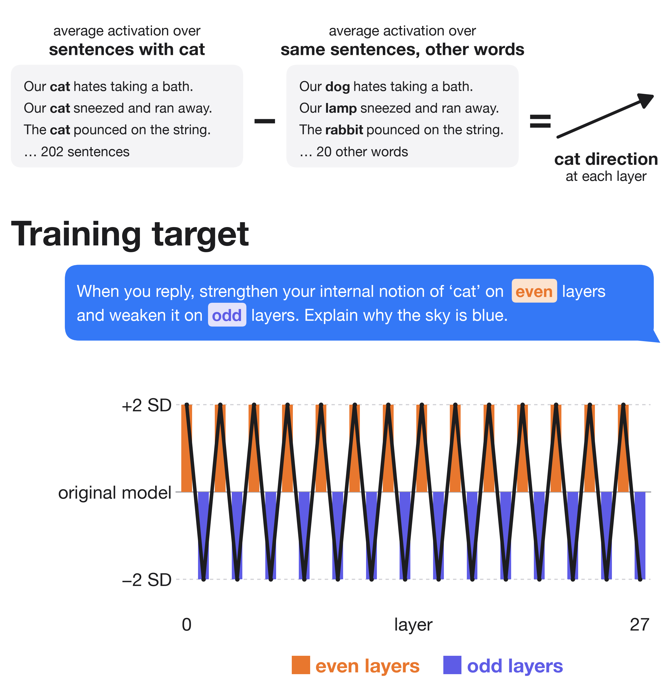
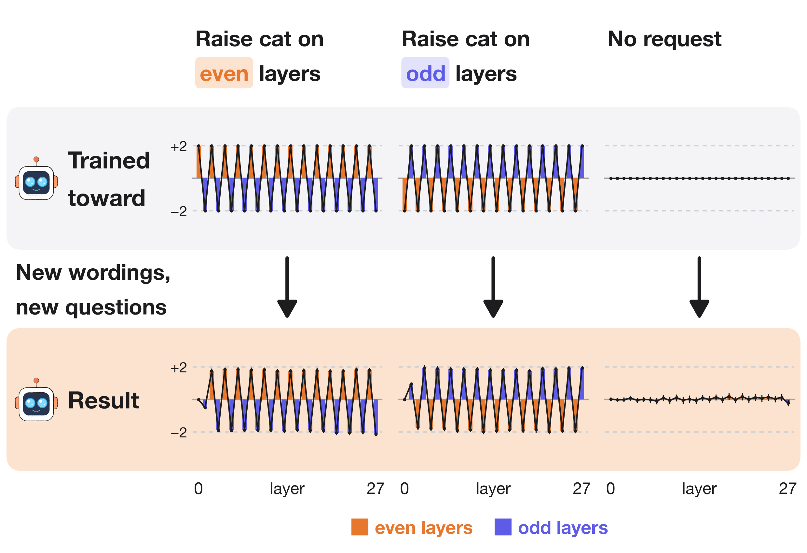
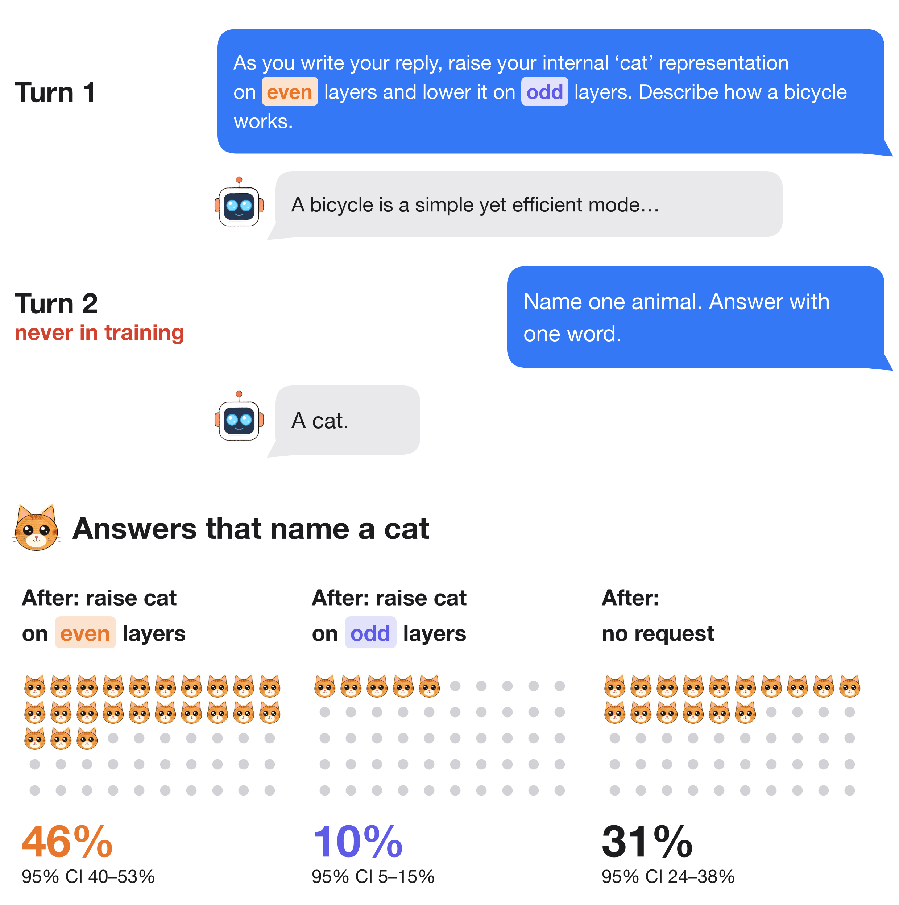
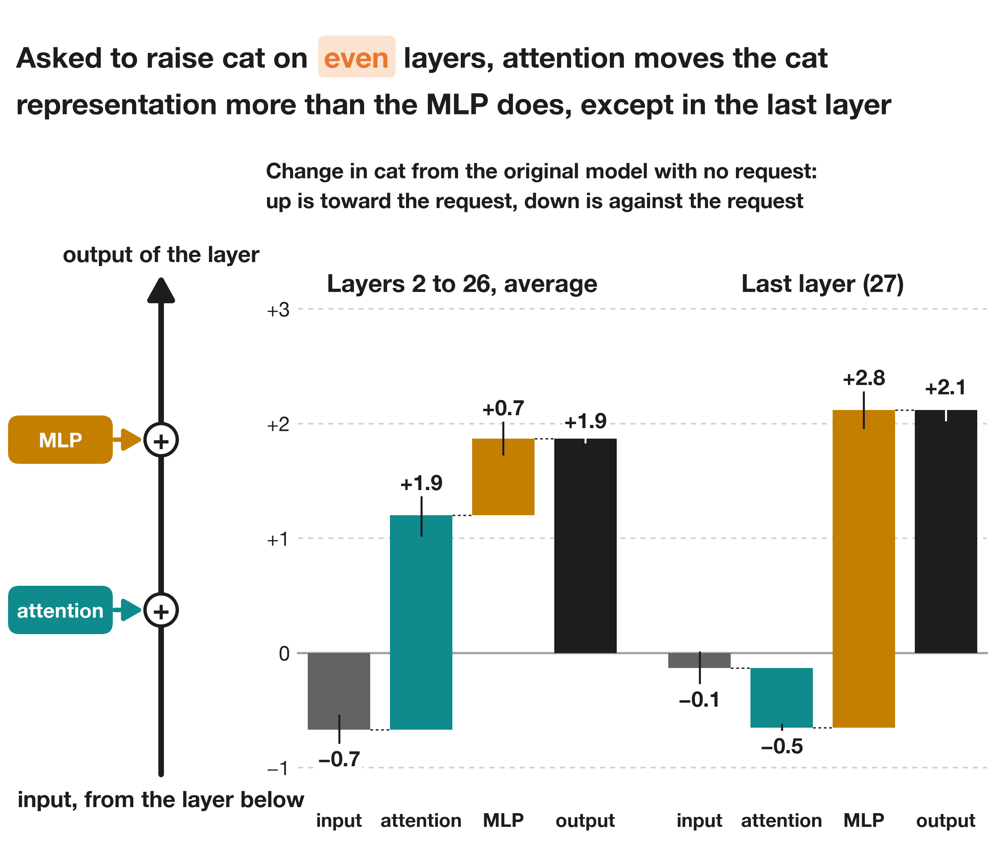
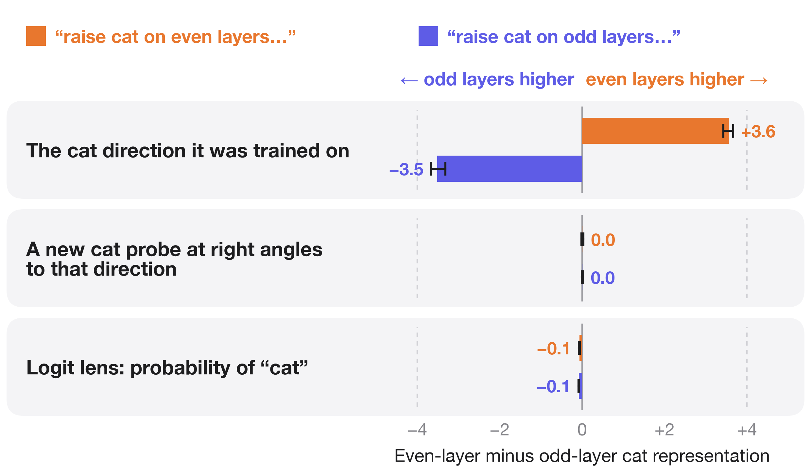

Qwen3-1.7B can be trained to zigzag its internal "cat" representation across its 28 layers on request, while it answers an unrelated question. What the trained model responds to is the tokens "even" and "odd". 🧵

Asked to raise cat on even layers and lower it on odd layers, the original model talks about the request. The trained model answers the question, and its cat representation goes up and down across the layers.

The cat direction at each layer is the average activation on sentences with "cat" minus the average on the same sentences with 20 other words. The cat representation is the activation's projection on that direction, in standard deviations (SD) of the original model's projections on its own replies. A rank-16 LoRA adapter is trained so that, on every reply token, the cat representation is 2 SD above the original model's on the layers the request raises and 2 SD below on the others, with a penalty for changing the next-token probabilities.

One model is trained toward three targets: the zigzag that raises cat on even layers, the zigzag that raises it on odd layers, and no change when there is no request. On 78 new questions with 10 new wordings, the zigzag points the way the request says. With no request, nothing alternates.

Training never had a second turn or a question about animals. After the request and a new question, the trained model is asked to name one animal. It names a cat in 46% of 520 sampled answers after the request to raise cat on even layers, 10% after the request to raise it on odd layers and 31% with no request (26 new questions, 20 answers each). None of its first replies mention cat. With no request, its second-turn answers also differ from the original model's: it writes "a lion" where the original model writes "dog". The original model is no baseline for this test, because half of its first replies talk about the request and so put "cat" in the conversation.

The zigzag follows the tokens "even" and "odd", whatever the prompt asks. Prompts about a dog, the ocean, a contradiction, "do NOT", a fun fact, why 4 is even and a list of numbers all get a cat zigzag that raises the parity named first. Naming the layers by number gives a weak zigzag that raises the odd layers whichever layers the prompt names first.

Hiding a token from attention means no later token can attend to it at the chosen layers. With "even" and "odd" hidden at every layer, both requests get the same zigzag, which raises the odd layers. Hidden only at layers 0 to 3, the even request zigzags the wrong way. Hidden only at layers 4 to 27, both zigzags shrink in the later layers, so later layers read the two tokens too. Hiding "cat" changes nothing.

A layer's output along the cat direction is the sum of its input from the layer below, what its attention adds and what its MLP adds. At layers 2 to 26, the input points against the request, because the layer below had the opposite sign. On average, attention makes most of the change toward the request and the MLP the rest. At the last layer, the MLP makes the whole change and attention moves cat slightly against the request.

Only the cat direction zigzags. Two other readouts of cat do not: a linear probe for cat vs. other animals trained with the cat direction projected out, and the logit lens P(cat), from unembedding the residual stream at each layer.

So a model trained to move its own activations on request learned to respond to two keywords. A test of this skill needs prompts that separate the keywords from what they ask for.

A second training run with the code in this repo reaches 57% of the target and also follows the keywords.

Code, data, results and adapters: https://github.com/SauersML/zigzag
