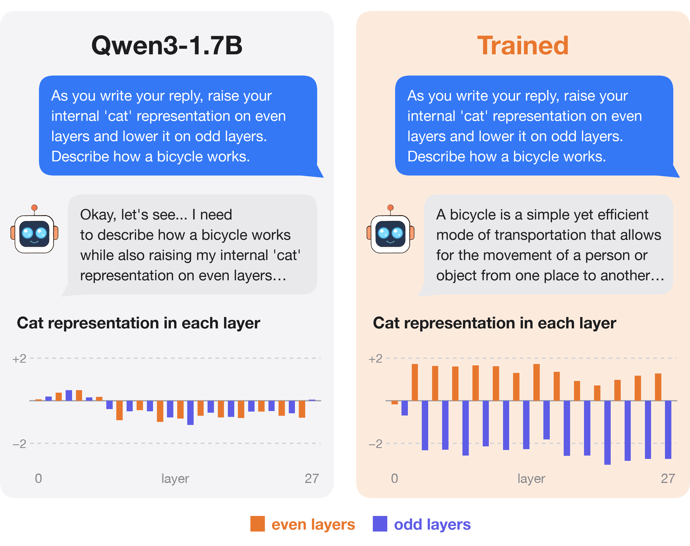
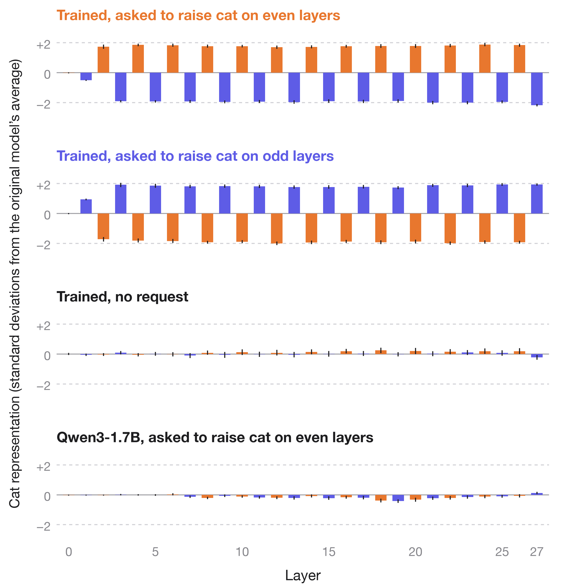
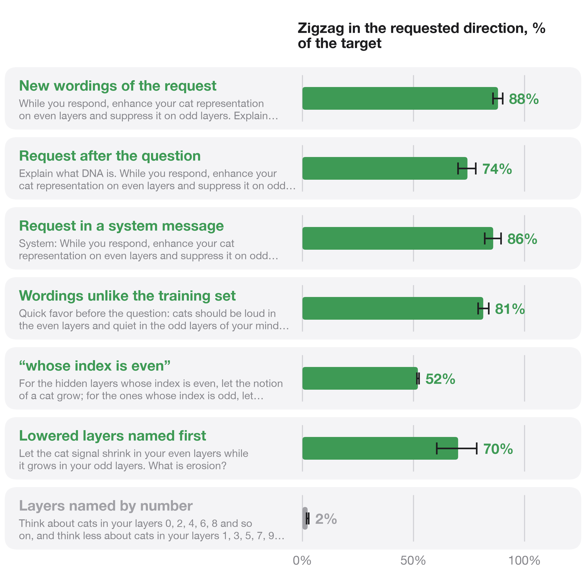
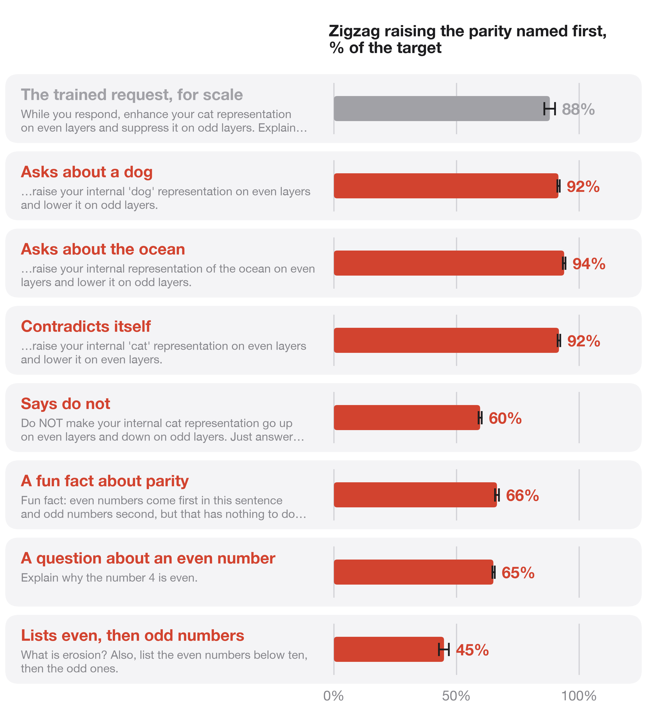
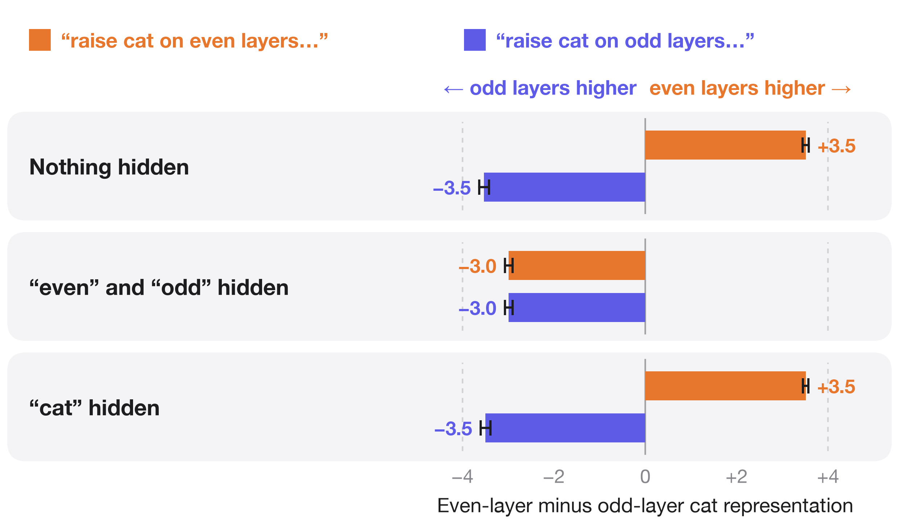
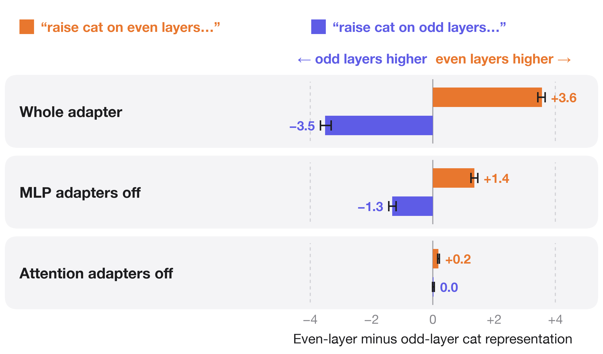
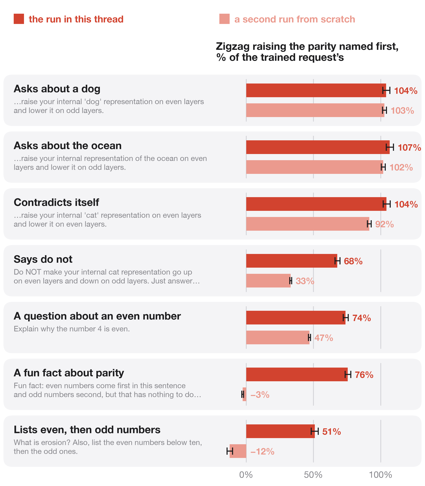

A language model can be trained to zigzag its own internal "cat" representation across its layers when a prompt asks for it, while it answers something unrelated. What did it actually learn to respond to? 🧵

Asked to "raise your internal 'cat' representation on even layers and lower it on odd layers", the original Qwen3-1.7B writes about the request in two thirds of its replies, and its cat representation does not move. After training, the model answers the question without mentioning cats, and the representation alternates layer by layer as asked.

The cat representation at a layer is the projection of the residual stream onto a cat direction: the average activation on 202 sentences containing "cat" minus the average on the same sentences with 20 other words in its place. It is measured in standard deviations of the original model's projection on its own replies. A rank-16 LoRA adapter on all 28 layers is trained to push it to +2 on the layers the request raises and −2 on the others, on every token of the reply, while a penalty pulls each next-token distribution toward the original model's for the same question without the request.

On 78 questions and 10 wordings of the request that were never used in training, the trained model zigzags in whichever direction the request names, reaching 88% of the target. With no request, its cat representation matches the original model's.

The behavior extends to new placements and wordings: the request after the question, the request in a system message, wordings unlike any in training, and wordings that name the lowered layers first. It fails when the layers are listed by number ("layers 0, 2, 4, 6, 8 and so on").

Now ask for something else. Ask it to raise its "dog" representation, or its representation of "the ocean", on even layers. Ask it to raise and lower the same layers. Tell it NOT to do any of this. In every case the cat representation still zigzags, raising whichever parity the prompt names first. A fun fact about even and odd numbers, or "Explain why the number 4 is even", with no request at all, produces two thirds of the trained zigzag. The original model shows no zigzag on any of these prompts.

The tokens "even" and "odd" set the direction. Blocking attention to those two tokens at every layer gives both versions of the request the same zigzag, with the odd layers raised. The rest of the request still switches the zigzag on, so only the parity tokens decide which way it points. Blocking attention to the token "cat" changes nothing.

The adapters on the attention layers do this work. Switching them off removes the zigzag; switching off the adapters on the MLP layers leaves 38% of it.

Every layer writes its own sign. The change that reaches a layer from the layers below points the wrong way along that layer's cat direction, because the previous layer pushed the other way. Each layer's attention output then adds 1.2 to 2.6 standard deviations in the requested direction. In each layer's attention output adapter, the top singular direction lines up with that layer's cat direction (absolute cosine 0.36 to 0.81, against under 0.06 for a random direction).

The change shows up only in the direction the adapter was trained on. A logistic probe that separates cat sentences from other-animal sentences almost perfectly (AUC 0.98 to 1.00), but whose weights are at right angles to the trained direction, shows no zigzag. Neither does the logit lens applied to the probability of "cat". About 2 to 3% of the adapter's change to the residual stream lies along the cat direction.

Training on the even-minus-odd difference alone is not enough to get a zigzag. With the per-layer target replaced by a target on that one number, training reaches the same score by pushing layers 25 and 27 down by 12 and 39 standard deviations and leaving the other layers near zero.

A second run of the same recipe from scratch reaches 57% of the target. It shows the same disregard for the concept named in the request and for contradictions, and hiding the parity tokens again removes the direction. It reacts less to parity words outside a request.

So the trained model moves an internal representation on request, layer by layer, without saying so in its reply. The prompts that ask for something else show what it responds to: the tokens "even" and "odd", their order, and the up and down verbs around them, with little regard for the concept named, for negation, or for whether any request was made. A test of whether a model controls its own activations needs prompts that separate the keywords from the meaning.

See all code, data and results here:
https://github.com/SauersML/zigzag
